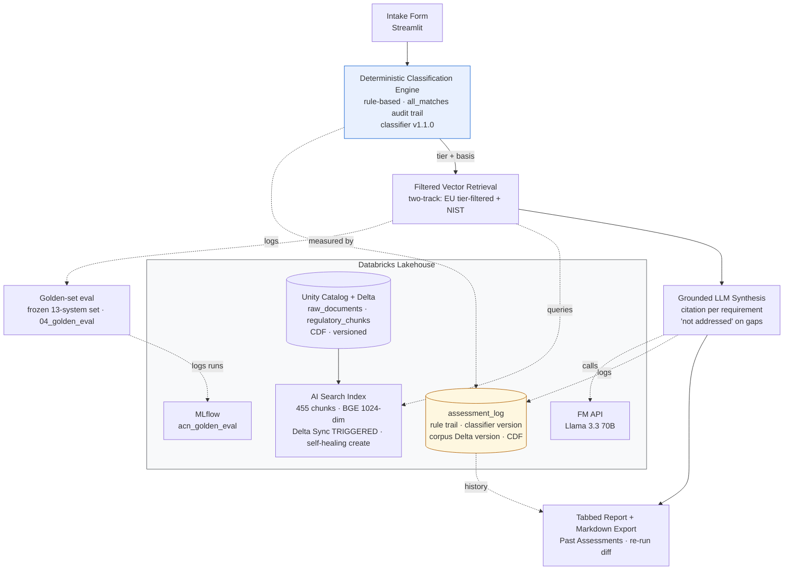

# AI Compliance Navigator — Databricks Architecture (v2.1)

## A RAG-powered regulatory mapping tool for the EU AI Act and NIST AI RMF

**Built by:** Aryaveer Singh
**Stack:** Databricks Lakehouse + Unity Catalog + AI Search (Vector Search) + Foundation Model APIs + MLflow + Streamlit
**Status:** v1 shipped and publicly deployed · v2 Phases 0 (partial), 2, 3, 4 built (Phase 4 formal close pending two evidence items) · Phases 5–6 remaining (see `docs/v2_build_plan.md`)

---

## Document purpose and how to read it

This document supersedes v2.0. Three jobs at once:

1. **As-built record of v1** — unchanged from v2.0 where nothing moved; divergences from the original design remain marked **[As-built]**.
2. **As-built record of v2 Phases 2–4** — the audit spine, assessment history + re-run diff, and the golden-set evaluation harness are no longer targets; they shipped, with evidence. Marked **[As-built v2]**, with measured numbers where they exist.
3. **Target architecture for the v2 remainder** — the GPAI overlay, housekeeping, and the tier-aware retrieval fix the eval surfaced. Marked **[v2 →]**. Items deliberately deferred are marked **[Deferred]** with the trigger that un-defers them.

`docs/v2_build_plan.md` holds the phased plan and gates; the repository is authoritative for code; this document holds the *what and why*.

---

## Executive Summary

The AI Compliance Navigator turns a plain-language description of an AI system into a structured, cited compliance report: an EU AI Act risk classification, the specific obligations that follow, a NIST AI RMF mapping, and a cross-framework checklist.

The load-bearing design decision, now validated three different ways: **the compliance determination is deterministic and auditable; the LLM only retrieves and synthesizes — it never classifies.** v1 proved the grounding property under test (starved retrieval invents zero citations). v2 Phase 2 made the tool accountable for itself (every assessment logged with rule trail, ruleset version, and the exact corpus version — reproducible via Delta time travel). v2 Phase 4 made retrieval quality **measured, not asserted**: a frozen golden set, MLflow-logged baselines, and — the credibility capstone — a tuning experiment that regressed and was *reverted and reported* rather than buried.

Three defects have now been caught by the tool's own instrumentation, each by a different layer: the corpus caught a classifier citation error (Finding 1); the audit log caught LLM over-synthesis (Finding 2); the eval's answer-key construction caught a classifier coverage gap (Finding 3). That pattern — the system auditing itself — is the architecture's thesis made empirical.

---

## Scope evolution

| | v1 (shipped) | v2 built so far | v2 remaining | v3+ (backlog) |
|---|---|---|---|---|
| Classification | 4-tier deterministic engine, `all_matches` audit field | **1.1.0**: +Annex III(5)(a) rule (Finding 3), version history in code | GPAI overlay (Art. 51–56, `is_gpai`) → 1.2.0 | — |
| Corpus | EU AI Act + NIST AI RMF + Playbook (455 chunks, Delta v5) | unchanged | Playbook noise strip + re-ingest (version advances) | +1 FS framework; broader FS stack; ISO 42001 (paywalled) |
| Retrieval | Two-track filtered vector search (managed) | measured (see Evaluation) | **tier-aware Article 50 fix** (eval finding); optional NIST framing v3 | reranking / hybrid |
| Synthesis | Llama 3.3 70B, cited JSON, defensive parser | citation coverage now **measured 100%** (13/13, two runs) | — | LLM-as-judge |
| Persistence | none (stateless) | **`assessment_log` shipped**: rule trail, versions, chunk IDs, corpus Delta version; history UI + re-run diff | — | — |
| Auth | none (public) / PAT (local) | pseudonymous `user_id`; **`st.login` deferred by decision** (trigger: live-public tier) | — | service principal, roles |
| Eval | 10-scenario suite + 3 synthesis gates | **11-scenario suite; frozen 13-entry golden set; MLflow baseline + tuned runs with numbers** | re-baseline after corpus change; measured Art. 50 fix | golden-set expansion, judge models |
| Export | Markdown | unchanged | — | PDF |
| Public tier | demo mode (classifier live, sample report) | unchanged — survived two backend outages untouched | — | live-lite (**[Deferred]**, trigger: throttling/CTA interest) |

---

## Databricks Architecture Overview

### Why Databricks — updated with tier reality **[As-built]**

| Capability | Benefit | Free Edition reality (verified during build) |
|---|---|---|
| Unity Catalog | Governed, versioned regulatory corpus | Full support |
| AI Search (formerly Vector Search) | Native retrieval, source/tier filtering | DELTA_SYNC supported; quota 1 endpoint; provisioning throttled (~15 min); **idle endpoints are reclaimed (~2 weeks observed) — see Operational resilience** |
| FM APIs — embeddings | `databricks-bge-large-en` (1024-dim) | Available and verified |
| FM APIs — LLMs | Managed Claude for synthesis | **Not available** on Free Edition; Databricks-hosted OSS models are (Llama 3.3 70B used) |
| Delta Lake + CDF | Audit trail; time-travel reproducibility | Full support; CDF *required* on Delta Sync sources; **time-travel reproduction demonstrated live** (Phase 2) |
| SQL warehouse (serverless) | Audit-log write path | Works via `databricks-sql-connector` + `sql`-scoped PAT |
| MLflow | Experiment tracking | Managed tracking verified; eval runs logged with params + metrics + artifacts |
| Databricks Apps | Enterprise hosting path | Unreliable on Free Edition; deferred behind the paid gate |

### Core pipeline



### Deployment topologies **[As-built]**

One codebase, run modes selected by configuration. Design invariant across all modes: **the deterministic classifier always runs live, in-process** (the public app now runs classifier 1.1.0 — Finding 3's fix is in production).

| Mode | Classifier | Retrieval | Synthesis | Where | Status |
|---|---|---|---|---|---|
| **Local live** | in-process | Databricks AI Search (PAT) | Databricks Llama 3.3 70B (PAT) | laptop | shipped; full live demo |
| **Public demo** (`DEMO_MODE=true`) | in-process (live) | none | pre-generated real sample | Streamlit Community Cloud | shipped; **survived two backend outages with zero user-visible impact** — the decision's empirical validation |
| **Public live** | in-process | Databricks (scoped cloud PAT) | Databricks (scoped cloud PAT) | Streamlit Community Cloud | code path exists; demo mode deliberately selected |
| **Public live-lite** | in-process | in-process (`bge-small` local) | provider API, hard $5 cap | Streamlit Community Cloud | **[Deferred by design]** — trigger: quota throttling or CTA interest |

---

## Component Implementation Details

### 1. Data layer — Unity Catalog + Delta Lake **[As-built, audit spine shipped]**

Canonical objects: catalog/schema `ai_governance.compliance_navigator`; volume `raw_docs`; `raw_documents` (CDF); `regulatory_chunks` (CDF; **the vector-search source, currently Delta version 5**); `framework_mappings.json` (in `data/`, consumed in-process — the Delta table in the original spec was never needed and not built); **`assessment_log`** (CDF, PK `assessment_id`).

Chunk metadata as designed and proven: `document_section`, `section_title`, `risk_tier`, `applicable_role`, `compliance_deadline` (verified strings), NIST `framework_function`/`category_id`/`subcategory_id`, deterministic `chunk_id` (`source:section_slug:index`) — idempotent reloads, stable citation keys, **and the join key the eval scores against**.

**`assessment_log`** **[As-built v2, Phase 2]** — every determination queryable and reproducible. Schema as specified in v2.0 (intake JSON, tier + `primary_basis` + `all_matches` rule trail, `classifier_version`, retrieval query + chunk IDs + `corpus_table_version`, LLM endpoint/temperature, full report JSON, `synthesis_status` including failures, latency). Shipped with:

- Writer `src/audit_log.py` (`databricks-sql-connector` → serverless SQL warehouse) that **never raises into the UI** — a logging failure cannot break an assessment.
- Privacy by design: no IP, no device fingerprint, no raw email, no chunk *text* (IDs + Delta version reconstruct it). Pseudonymous `user_id`; conditional privacy notice. `st.login` **[Deferred]** to the live-public trigger.
- Erasure runbook (`docs/erasure_runbook.md`): right-to-erasure = `DELETE` **plus** `VACUUM` past retention — time travel retains deleted rows until then.
- **Time-travel reproducibility demonstrated**: a logged row's `corpus_table_version` + chunk IDs reproduced the exact Article 6 text the assessment saw (`scripts/reproduce_assessment.py`).
- Logging scoped to governed-backend modes; demo-mode suppression proven by test.

### 2. Ingestion + chunking **[As-built — unchanged from v2.0]**

`notebooks/01_document_ingestion.py`. PyMuPDF (not pypdf — EUR-Lex kerning); hardened structure-aware chunking (validated `Article N` headings with monotonic numbering; annexes chunked separately — Annex III must be retrievable; NIST longest-span-per-subcategory dedupe). Corpus: **455 chunks** — EU 185, NIST RMF 85, Playbook 185. **[v2 →]** Playbook page-furniture noise strip + re-ingest is Phase 5; the corpus Delta version will advance, and the eval re-baselines after (see Evaluation).

### 3. Embeddings + AI Search index **[As-built + operational resilience]**

`notebooks/02_create_vector_index.py`. Endpoint `compliance-navigator-endpoint` (STANDARD, created from code); single Delta Sync index `regulatory_chunks_index`, managed `databricks-bge-large-en` (1024-dim), TRIGGERED, PK `chunk_id`. Single-index + source/tier filtering (not index-per-framework) stands.

**Operational resilience — the Phase 4 hardening [As-built v2]:** Free Edition **reclaims idle AI Search endpoints** (observed twice: ~6 weeks, then ~2 weeks idle). Reclamation can leave an **orphaned Unity Catalog index registration** with no serving backend — and the orphan is not reliably visible to `get_index()`, which is endpoint-scoped; two reclamation incidents produced two differently-shaped orphans. The durable design, now in the notebook: **creation-as-probe** — a healthy fast-path reuses the index only when *both* authorities agree (describe() succeeds AND the endpoint lists the index); otherwise attempt creation and treat a name collision as "delete the UC entity, wait out the async teardown, retry." The sync path polls `describe()` manually through provisioning → sync → READY (SDK `wait_until_ready` signature drift; all control-plane transitions on this platform are eventually consistent — **poll, never assume**). Net effect: a reclamation recovery is now *open nb02 → Run All*. The Delta layer was untouched in both incidents — durable governed storage vs rebuildable serving state, validated by unplanned outages. **[v2 →]** SDK migration `databricks-vectorsearch` → `databricks-ai-search` is Phase 5 (old import re-exports meanwhile); fresh serverless environments lack the package — every retrieval notebook opens with `%pip install` + restart.

### 4. Classification engine **[As-built, now versioned with history]**

`src/classification_engine.py`. Deterministic, mirroring the Act's evaluation order: **Art. 5 (prohibited) → Art. 6/Annex III (high-risk) → Art. 50 (transparency) → minimal.** Output (`ClassificationResult`): tier, `primary_basis`, applicable articles, role, verified deadline, reasoning, confidence, `all_matches` (every rule that fired — the determination's own audit trail, persisted to `assessment_log`).

**`CLASSIFIER_VERSION` is live and has history** (the constant doubles as a changelog in `src/utils.py`):
- **1.0.0** — v1 as shipped.
- **1.0.1** — Finding 1: real-time biometric ID basis corrected 5(1)(d) → 5(1)(h) per enacted Reg. 2024/1689 numbering (the corpus caught the classifier). The audit log holds rows under both versions; the history UI diffs them.
- **1.1.0** — Finding 3: **Annex III(5)(a) rule added** (government/public-sector benefits eligibility previously fell through to minimal risk) — caught by golden-set tier verification *before any score was computed*. Permanent scenario S11.
- **[v2 →] 1.2.0** — GPAI overlay (Phase 5): `is_gpai: bool` + `gpai_articles` as a **parallel regime, not a fifth tier** (2 Aug 2025 applicability; systemic-risk threshold documented as sub-case). Upgrades S10 to a hard assertion.

### 5. Retrieval **[As-built + measured + the known gap]**

`src/retrieval.py` — two-track filtered retrieval (EU: `source=eu_ai_act` AND `risk_tier ∈ {tier,'all'}`; NIST: source-filtered, no tier concept). Rich query construction (description + purpose). Tier-filter integrity proven three times (v1 gate, Phase 2 forensics, post-rebuild).

**What measurement added (Phase 4):** EU track retrieves at **0.641 hit-rate@10** against tight expected lists; prohibited and minimal entries retrieve perfectly; high-risk entries lose Arts. 9/14 to ranking competition from the large `all`-tier pool; **all three limited-risk entries score 0.0 — Article 50 never surfaces in top-10 for conversational system descriptions**. That gap is the retrieval layer's one known systematic defect, it causally explains the single grounding violation (below), and its fix is deliberately **targeted** (**[v2 →]** Phase 5: tier-aware handling on the limited-risk path) rather than global — because the global approach was tried, measured, and rejected (see Evaluation). A uniform NIST-track governance reframing **regressed** NIST hit-rate 0.231 → 0.192 and was reverted; retrieval determinism was confirmed as a side effect (EU per-entry scores identical across runs).

`src/retrieval_local.py` (live-lite in-process variant) **[Deferred]** with its tier.

### 6. LLM synthesis **[As-built — guarantees now measured]**

`src/llm_synthesis.py`. Databricks-hosted `databricks-meta-llama-3-3-70b-instruct` (fallback 3-1-8b), temperature 0.1, defensive `_extract_json` parser. Grounding rules unchanged: cite every requirement; on gaps emit *"Not addressed in retrieved sources — manual review recommended"*; the tier is input, never output.

What was aspirational is now measured: **citation coverage 1.00 across 13 systems, 13/13 schema-valid JSON, reproduced across two full eval runs.** One grounding defect is known, bounded, and understood: on one limited-risk entry (G-08), the report surfaces Article 9 — **entry-deterministic** (recurred identically across both runs at temp 0.1), and causally downstream of the Article 50 retrieval gap: when the on-point transparency article is never retrieved, synthesis grounds itself in general provisions whose text cross-references high-risk obligations. The fix is therefore a retrieval fix, not a prompt fix — scheduled with it in Phase 5, and the eval's `must_not_include` machinery (built from Finding 2's seed case) is the regression guard.

### 7. Frontend, history, and secrets **[As-built]**

`app.py` (Streamlit). Intake → instant in-process classification → tabbed report (EU obligations / NIST mapping / checklist / export) → Markdown download; persistent disclaimer; graceful degradation (no stack trace reaches the UI).

**Assessment history + re-run diff [As-built v2, Phase 3]:** a "Past Assessments" tab (live mode only) lists the user's logged rows; reopening renders the stored report; **"re-run against current"** executes the fresh pipeline and diffs: tier changed y/n, basis change, EU obligations added/removed by article, NIST delta — separating deterministic change from synthesis variability. Re-runs are themselves logged. Headline capture: a FaceWatch assessment stored under classifier 1.0.0, re-run under 1.0.1 → **"Basis CHANGED: 5(1)(d) → 5(1)(h)"** — *the regulation's enacted numbering changed; here is exactly what changed in the determination.*

Secrets model unchanged: local `secrets.toml` (gitignored) with narrowly-scoped PATs; cloud secrets manager; per-surface tokens. Operational note: **PAT expiry silently degrades live mode — calendar reminder is part of the runbook** (current token expires late Oct 2026).

### 8. Evaluation **[As-built v2 — the Phase 4 centerpiece]**

Two instruments now exist:

**Classifier suite** (`tests/test_classification.py` + `test_scenarios.json`): 4 unit tests + **11 scenarios** (S1–S11) — tier coverage, rule ordering (S5), multi-match first-wins (S9), minimal fall-through (S8), public-benefits coverage (S11, from Finding 3), GPAI documented edge (S10 → hard assertion in Phase 5). Plus the three synthesis gates (schema ×3, citation coverage, starved-retrieval no-invention).

**Golden-set retrieval eval** (`tests/golden_set.json` + `notebooks/04_golden_eval.py` → MLflow experiment `acn_golden_eval`):

- **13 entries** (2 prohibited / 6 high / 3 limited / 2 minimal / 1 multi-match), expected EU sections (chunk-ID slugs) and NIST subcategories per entry, derivation-based source notes. **Frozen in git before any scoring** (commit `ab3f361`) — the answer key provably predates the numbers. Every entry's expected tier verified against the live classifier pre-freeze (which is how Finding 3 surfaced).
- **Metrics, defined in code next to the math:** hit-rate@observed-k per track (section-slug match on chunk IDs; macro mean; k is *observed* from the product, not chosen by the eval); citation coverage over schema-valid syntheses; `must_not_include` violations matched by article-number token (the G-min-01 check, generalized).
- **Runs logged with full provenance:** params include the freeze commit, classifier version, query-template version, endpoints, observed k; per-entry results as an MLflow artifact.

| Metric | Baseline (`5025d91b`) | Tuned v2 framing (`5fdecb73`) | Outcome |
|---|---|---|---|
| EU hit-rate @10 | **0.641** | 0.641 | identical → retrieval determinism confirmed |
| NIST hit-rate @10 | **0.231** | 0.192 | **regression → change reverted** |
| Citation coverage | **1.00** | 1.00 | measured, both runs |
| Schema-valid | 13/13 | 13/13 | |
| Must-not violations | 1 (G-08) | 1 (G-08) | entry-deterministic; root cause = Art. 50 retrieval gap |

The regression is **reported in the public README** alongside the baseline — the eval's purpose is catching plausible-sounding changes that make things worse, and the record shows it doing exactly that. **[v2 →]** Phase 5 protocol: corpus re-ingest → re-baseline run → tier-aware Art. 50 fix → measured run (one attributable change per run; the golden set changes only by the pre-authorized G-11 GPAI update, its own commit before any P5 scoring).

---

## Regulatory currency **[As-built — verified]**

Deadlines verified against **Reg. (EU) 2024/1689, Art. 113**: prohibitions 2 Feb 2025; GPAI 2 Aug 2025; general application incl. high-risk Annex III and Art. 50 transparency 2 Aug 2026. Digital Omnibus flux documented — dates are cited and flagged for counsel verification, never asserted as immutable. Standing rule: no date ships in a demo without re-verification at source (next checkpoint: Phase 5's GPAI date before hardcoding).

---

## Cost model **[As-built]**

| Phase | Actual / budget | Notes |
|---|---|---|
| v1 build | **$0 actual** | Free Edition throughout |
| v2 through Phase 4 | **$0 actual** | Eval runs consumed LLM quota only; endpoint = fair-usage quota, not dollars |
| v2 remainder | ≤ $5 hard cap (live-lite key, only if that tier un-defers) | No subscriptions in v2 |
| Paid-Databricks gate | decision, not default (Phase 6, vs ≥4 weeks traction data) | Entry criteria pre-committed: budget alerts, service principal replacing PATs, verified endpoint base-price plan (**AI Search endpoints bill continuously once an index exists** on paid tiers) |

---

## Repository structure (as of `8cb3c5a`, branches `v2` = `main`)

```
ai-compliance-navigator/
├── README.md                        # incl. measured eval results table (both runs)
├── architecture.md                  # this document (v2.1)
├── requirements.txt
├── .streamlit/config.toml           # secrets.toml local-only, gitignored
├── docs/
│   ├── worklog.md                   # maintained privately (owner build journal)
│   ├── v2_build_plan.md
│   └── erasure_runbook.md
├── notebooks/
│   ├── 01_document_ingestion.py
│   ├── 02_create_vector_index.py    # reclamation-aware, self-healing
│   ├── 03_test_pipeline.py
│   └── 04_golden_eval.py            # eval harness → MLflow (acn_golden_eval)
├── scripts/
│   └── reproduce_assessment.py      # time-travel reproduction from a log row
├── src/
│   ├── classification_engine.py     # 1.1.0 (+GPAI overlay → 1.2.0 in Phase 5)
│   ├── retrieval.py                 # two-track filtered retrieval (measured)
│   ├── llm_synthesis.py
│   ├── audit_log.py                 # assessment_log writer + history read path
│   └── utils.py                     # canonical config; CLASSIFIER_VERSION changelog
├── app.py                           # form → report → history/diff → export
├── data/
│   ├── framework_mappings.json
│   └── sample_report.json
└── tests/
    ├── test_classification.py       # 4 unit + S1–S11
    ├── test_scenarios.json
    └── golden_set.json              # FROZEN at ab3f361
```

*(Live-lite artifacts — `retrieval_local.py`, `embed_corpus_local.py`, `corpus_embeddings.npz` — deferred with their tier.)*

---

## Key design decisions (updated)

| Decision | Plan | As-built / current | Rationale / evidence |
|---|---|---|---|
| Risk classification | Rule-based | Rule-based, **versioned with changelog** (1.0.0 → 1.0.1 → 1.1.0); GPAI overlay next | Auditability; two rule defects found and fixed *by the system's own instruments*, both version-stamped in the log |
| Vector store | Two indexes | One Delta Sync index + source/tier filtering; **creation-as-probe self-healing** | Quota fit; filtering does the job; Free Edition reclaims idle endpoints, so rebuild must be unattended-safe |
| Eval honesty | "measure retrieval" | **Freeze-before-score** (answer key committed before any number exists); observed-k; regressions published | The numbers mean something only if the answer key provably predates them |
| Tuning discipline | — | **One change per measured run; revert on regression; keep the experiment in history** | v2 NIST framing: tried, −0.038, reverted — the harness caught a plausible change making things worse |
| LLM | Claude via external endpoint | Llama 3.3 70B Databricks-hosted; one-line swap preserved | Free Edition gating; grounding now *measured* at 100% coverage |
| Persistence | Deferred | `assessment_log` + history + re-run diff shipped | "The regulation changed — here's exactly what changed in your obligations" works live |
| Public URL | Streamlit Cloud | Demo mode (classifier live) | Survived two backend outages with zero user impact — the decision's empirical proof |
| Deployment spend | — | $0 to date; paid-Databricks is a gated Phase 6 *decision* vs traction data | Spend follows traction, not hope |

---

## Change log

**v2.1 (this document)**
- Phases 2–4 moved from target to **as-built with evidence**: audit spine (writer, privacy exclusions, erasure runbook, time-travel repro), history + re-run diff (headline basis-change capture), golden-set eval (frozen set `ab3f361`, harness, MLflow runs `5025d91b`/`5fdecb73`)
- Measured numbers added: EU 0.641 / NIST 0.231 hit-rate@10, citation coverage 1.00, 13/13 schema-valid; tuning regression (−0.038) documented with the revert
- Classifier version history recorded (1.0.1 Finding 1; **1.1.0 Finding 3** — Annex III(5)(a) added, S11); suite now 11 scenarios
- Known-gap register added: Article 50 absent from limited-risk top-10 (3/3 entries) with the G-08 violation traced to it; targeted Phase 5 fix specified
- Operational resilience section added: endpoint reclamation (~2-week window), orphaned UC registrations, creation-as-probe self-healing nb02, poll-never-assume rule
- `st.login` and live-lite tier marked **Deferred** with explicit triggers (they were v2 targets in v2.0)
- Repo structure updated to actual `8cb3c5a` state; three-findings/three-instruments framing added to the summary

**v2.0** — as-built v1 + v2 target architecture. Preserved in git history.
**v1.0 (March 2026)** — original MVP design. Preserved in git history.

---

*Document Version: 2.1 · Supersedes: 2.0*
